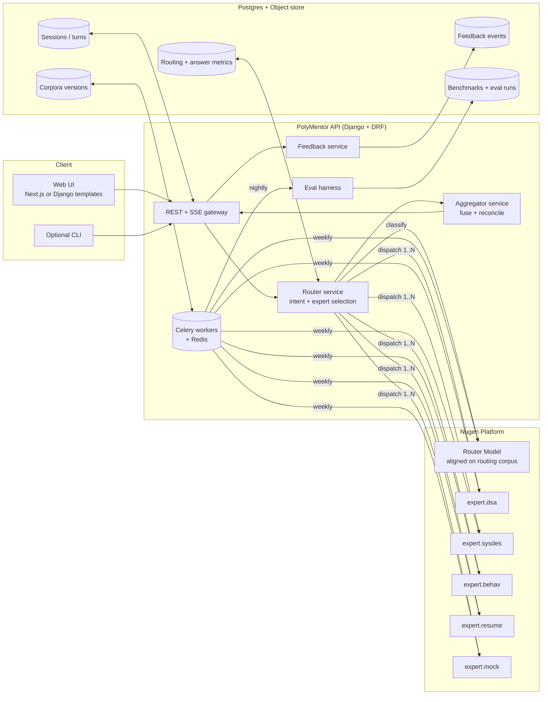
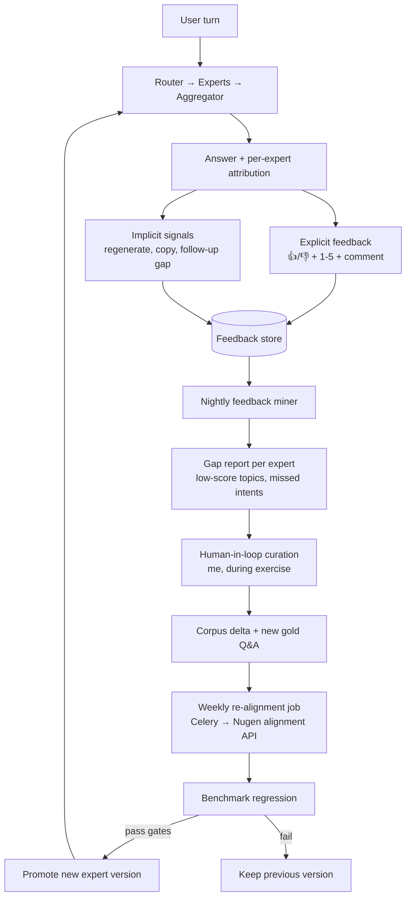
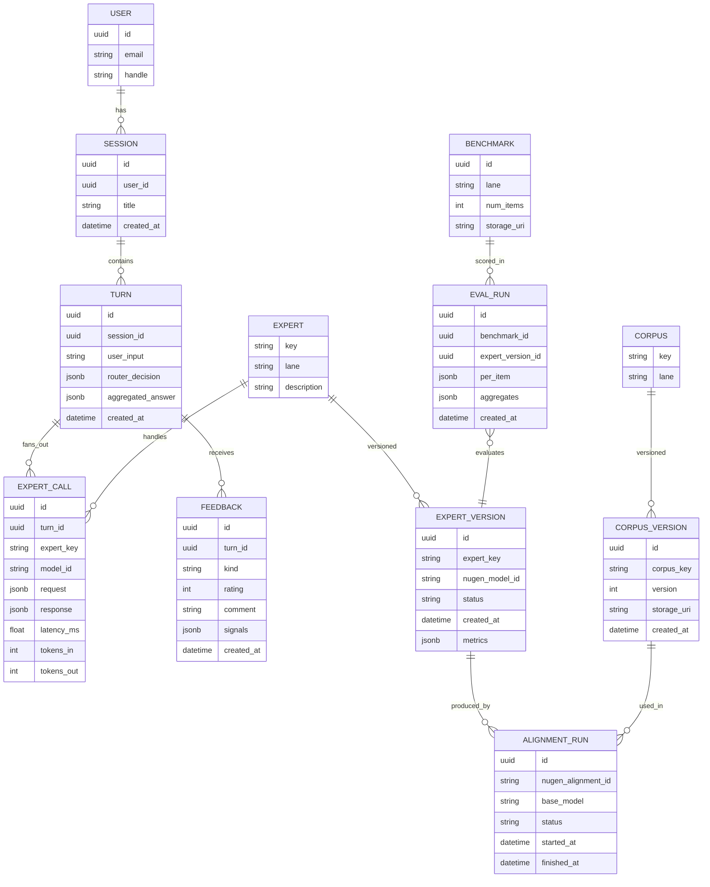
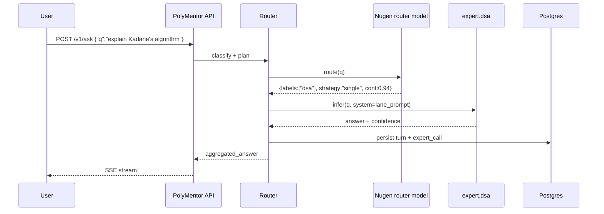
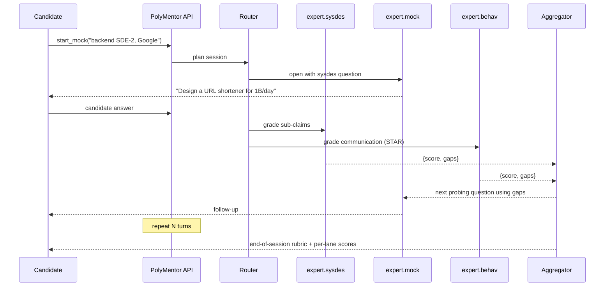
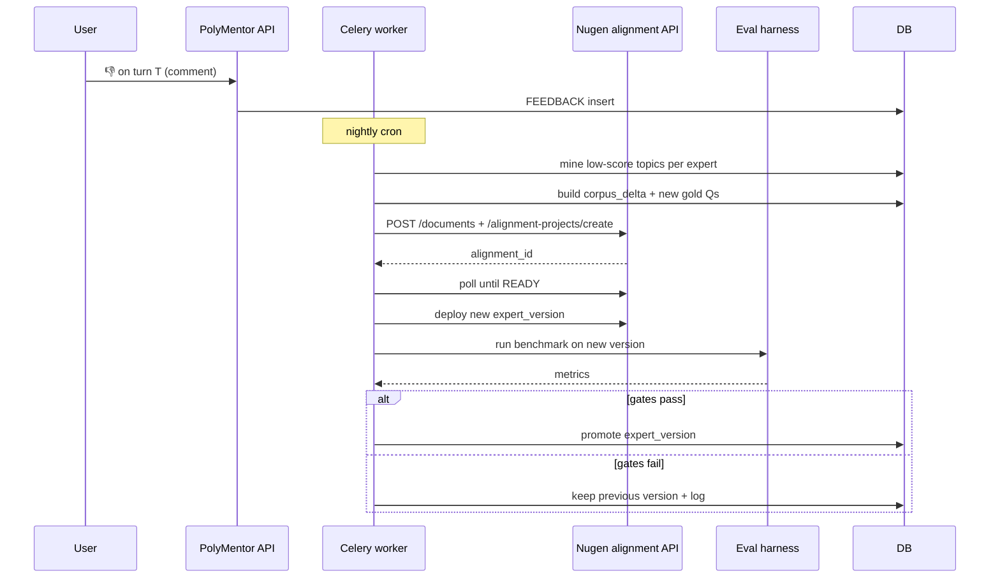

# PolyMentor — Architecture

> **Design document, written before the build.** What shipped is described in the
> [README](../README.md) and measured in [EVALUATION.md](../EVALUATION.md). Main changes
> during the build: turns run synchronously in gunicorn thread workers (no Celery worker
> or Redis); the UI is Tailwind + vanilla JS streaming (no HTMX); experts' decisions are
> extracted from prose because 3B models ignored claim tags; re-alignment is done on the
> Nugen dashboard and promoted through the `promote_expert` eval gate; the router is
> keyword + corpus BM25 with an LLM fallback rather than a separately aligned model.

> AI tech-interview coach powered by a **router (mother) model** that delegates to a **fleet of domain-aligned expert models** on Nugen, aggregates their expertise, and **improves over time** from candidate feedback and benchmark drift.

---

## 1. Problem & product

**User pain.** Interview prep is fragmented: DSA on one platform, system design on YouTube, behavioral on blogs, resume feedback on paid reviewers, mocks on expensive humans. Generic LLMs answer all of these — fluently, often wrongly, and without an evaluation loop.

**Product.** A single conversational surface where a **router** figures out which specialist(s) a question needs, each specialist is a **Nugen-aligned expert** trained on a curated corpus for that lane, and an **aggregator** fuses expert outputs for compound tasks like full mock interviews.

**Why it fits the brief.**
- Mother/router → expert fleet ✅
- Aggregates fleet expertise ✅
- Improves over time via feedback → re-alignment ✅
- Meaningful real-world problem ✅
- Meta-relevant to Nugen's own hiring thesis ✅
- Scope realistic for 96 h + $50 credits ✅

---

## 2. Expert fleet

Five lanes. Each expert = one Nugen domain-aligned model on a small, high-quality public corpus + a gold benchmark.

| # | Expert           | Lane                                            | Corpus (public only)                                                                 | Base model                  |
|---|------------------|-------------------------------------------------|--------------------------------------------------------------------------------------|-----------------------------|
| 1 | `expert.dsa`     | Data structures & algorithms reasoning          | Curated notes on complexity, patterns (two-pointer, sliding window, DP, graphs)      | small `alignment_ready` reasoning model |
| 2 | `expert.sysdes`  | System design (scalability, consistency, caches)| Classic distributed systems notes, CAP, consistent hashing, queueing, caching        | small `alignment_ready` reasoning model |
| 3 | `expert.behav`   | Behavioral / STAR / leadership principles       | Structured STAR templates, situational frameworks, bias-free rubrics                 | small instruction model     |
| 4 | `expert.resume`  | Resume & JD-fit critique                        | Resume-writing style guides, bullet-impact patterns, keyword/JD-alignment heuristics | small instruction model     |
| 5 | `expert.mock`    | Interviewer persona (asks follow-ups, scores)   | Interview rubrics, probing patterns, scoring criteria                                | small instruction model     |

**Corpus hygiene:** `.md`/`.txt` only, public knowledge, no org/PII content, metadata (version, effective date), per the lessons from the first exercise.

**Benchmark per expert:** 15–25 gold Q&A pairs grounded in that lane's corpus. Used both to (a) create the alignment and (b) regression-test after every re-alignment.

---

## 3. High-level architecture (C4 container view)



**Why a Nugen-aligned router (not just an if/else).** A routing model aligned on labeled intents handles ambiguity ("prep me for a Google backend loop next week" → multi-expert) and lets the router *itself* get better from feedback — same alignment pipeline as experts. We keep a cheap **rules fast-path** for obvious queries to save credits.

---

## 4. Router (mother) design

### Responsibilities
1. **Intent classification** — one or more of `{dsa, sysdes, behav, resume, mock, meta}`.
2. **Decomposition** — split compound requests into sub-prompts per expert.
3. **Expert selection** — pick 1–N experts + a `strategy` (`single | parallel | pipeline | debate`).
4. **Budgeting** — cap tokens / parallel fan-out based on query class.
5. **Confidence** — emit a routing confidence; low confidence → ask clarifying question instead of hallucinating a route.

### Routing corpus (what the router is aligned on)
A JSONL dataset of `{query, labels[], strategy, rationale}` ~300–500 examples drawn from public interview questions, synthetic variations, and edge cases (ambiguous, out-of-scope, PII attempts, prompt-injection).

### Strategies
| Strategy | When | Flow |
|----------|------|------|
| `single`   | Pure lane query ("explain quicksort") | 1 expert → return |
| `parallel` | Independent sub-questions ("DSA tips + resume review") | fan-out → aggregator concatenates with headings |
| `pipeline` | Dependent steps ("design URL shortener, then grill me on it") | `sysdes` → `mock` consumes previous answer |
| `debate`   | High-stakes / low-confidence answers | 2 experts answer same prompt → aggregator reconciles with a rubric |

---

## 5. Aggregator design

Not a prompt-stuffing hack — a small, explicit reconciler:

1. **Normalize** each expert output to `{answer, citations[], confidence, caveats[]}`.
2. **Deduplicate** overlapping claims.
3. **Reconcile** contradictions via rubric: prefer the lane-owning expert for its sub-claim.
4. **Compose** a final response with per-section attribution: *"System design (expert.sysdes)…"*, *"Behavioral framing (expert.behav)…"*.
5. **Abstain-aware**: if any critical expert returned "insufficient evidence," the aggregator surfaces it instead of papering over.

Mock interview is the showcase: `mock` plays interviewer; after each candidate answer, the router silently calls the relevant lane expert for a model answer; aggregator produces per-turn **scored feedback** (clarity, correctness, depth) and an end-of-session rubric.

---

## 6. Improvement loop (how the system gets better over time)



**Gates before promotion (from the enterprise brief in the earlier exercise):**
- ≥85% rubric accuracy on that expert's gold set
- ≥90% correct abstention on insufficient-evidence items
- ≤5% critical hallucination
- No regression >3 pp on any peer expert's shared-topic items

**Router improvement:** feedback on *wrong routing* (user flags "this needed system design, not DSA") is a labeled example that feeds the router's own re-alignment set.

**Credit-aware fallback:** if Nugen credits are tight, "improvement" degrades gracefully to **in-context exemplar refresh** (new few-shots pulled from top-rated past turns) without re-alignment — same code path, just skips the training job.

---

## 7. Data model



Everything about an answer is traceable back to the exact `expert_version` + `corpus_version` + `benchmark` scores — this is the "audit log" story from the enterprise brief, applied to our own product.

---

## 8. Key sequence diagrams

### 8.1 Single-expert query



### 8.2 Mock interview (pipeline + aggregator)



### 8.3 Feedback → re-alignment



---

## 9. API surface (DRF)

| Method | Path                              | Purpose |
|--------|-----------------------------------|---------|
| POST   | `/v1/sessions`                    | Create session |
| POST   | `/v1/sessions/{id}/ask`           | Single-turn ask (SSE stream) |
| POST   | `/v1/sessions/{id}/mock/start`    | Begin mock interview |
| POST   | `/v1/sessions/{id}/mock/answer`   | Submit candidate turn |
| POST   | `/v1/turns/{id}/feedback`         | 👍/👎 + rating + comment |
| GET    | `/v1/experts`                     | List experts + current versions + last metrics |
| GET    | `/v1/experts/{key}/versions`      | Version history + eval scores |
| POST   | `/v1/admin/realign/{expert_key}`  | Trigger re-alignment (admin, Celery) |
| GET    | `/v1/admin/eval/{run_id}`         | Eval run detail |

Auth: simple token for admin endpoints; session cookie or anon-session for user endpoints (showcase, not a real auth product).

---

## 10. Tech stack

Following project rules (Django-first, services layer, ORM, DRF, Celery/Redis, Postgres):

- **Backend:** Django 5 + Django REST Framework
- **Business logic:** `services.py` per app (`routing`, `experts`, `aggregation`, `feedback`, `alignment`)
- **DB:** Postgres (Supabase or Neon free tier)
- **Cache / queue:** Redis (Upstash free tier)
- **Workers:** Celery (one worker + beat for cron)
- **Frontend:** minimal — Django templates + HTMX + Tailwind (fast; no SPA cost). Fallback: Next.js if time.
- **Streaming:** SSE via DRF streaming response
- **Nugen client:** thin wrapper around `/documents`, `/benchmarks`, `/alignment-projects`, `/models/aligned`, `/models/{id}/deployment`, `/inference/chat/completions`
- **Deployment:** Render.com or Railway (free/cheap, HTTPS, env vars, Postgres+Redis add-ons). Public URL out of the box.
- **Observability:** structured JSON logs + a `/healthz` + a `/metrics` page showing routing distribution + per-expert scores (also serves as demo visualization).
- **Testing:** pytest-django for services + a smoke test that mocks Nugen client.

Django apps:
```
polymentor/
  apps/
    accounts/
    sessions/        # Session, Turn models + views
    routing/         # Router service, strategies
    experts/         # Expert, ExpertVersion, Nugen client
    aggregation/     # Aggregator service
    feedback/        # Feedback model + miner
    alignment/       # Alignment runs, eval harness, Celery tasks
    corpora/         # Corpus versions + upload utilities
  config/
  services.py per app
```

---

## 11. Non-goals (explicit cuts)

- Real user auth / billing
- Multi-tenant isolation
- Vector DB / embeddings-based RAG in v1 (we lean on train-time alignment; **optional add-on** if time permits for `expert.sysdes` where facts are large)
- Mobile app
- Fine-tuning our own models outside Nugen

---

## 12. Risks & mitigations

| Risk | Mitigation |
|------|------------|
| Alignment is weak on small corpora (we saw this in exercise 1) | Keep lanes narrow; add high-repetition definition blocks; evaluate with gold phrases; add RAG fallback for `sysdes` if needed |
| Credits run out | Rules-based routing fast-path; cache expert outputs by (lane, normalized_prompt); offer "demo mode" with cached responses |
| 96 h is tight | Day-by-day milestones (below); cut `debate` strategy if time |
| Re-alignment latency (5–15 min) | Done out-of-band in Celery; UI shows "new version candidate pending" badge |
| Prompt injection via mock interview user input | Strip control tokens, cap length, never pass raw user text as system prompt |
| Public URL abuse | Per-IP rate limit (Django ratelimit); global daily token cap |

---

## 13. 96-hour execution plan

| Window | Deliverable |
|--------|-------------|
| **H 0–8** | Repo scaffold, Django apps, Postgres, Redis, Celery, Nugen client wrapper, 1 expert end-to-end (`expert.dsa`) deployed and callable |
| **H 8–24** | Build remaining 4 corpora + benchmarks, kick off alignments in parallel, draft routing corpus, deploy mother router |
| **H 24–48** | Router + aggregator services, `single`/`parallel`/`pipeline` strategies, SSE streaming, basic UI (ask + mock) |
| **H 48–72** | Feedback capture, eval harness, nightly miner (Celery beat), re-alignment Celery task, admin metrics page |
| **H 72–88** | Polish UI, mock-interview rubric, caching + rate-limits, deploy to Render with Postgres/Redis add-ons, write README + loom demo |
| **H 88–96** | Buffer: fix the one thing that will break, record demo video, submit |

---

## 14. What a reviewer will see

1. **Public URL** → land on PolyMentor, pick "Ask" or "Mock interview."
2. Ask a question → see **router decision** ("sent to `expert.sysdes`, confidence 0.91") + streamed answer with per-expert attribution.
3. Start a mock → multi-turn session with per-turn scoring and end rubric.
4. 👎 any answer → feedback captured → `/admin/experts` shows pending re-alignment candidate.
5. `/admin/metrics` → routing distribution, per-expert accuracy over versions, benchmark trend chart.
6. **GitHub repo** → clean Django structure, services layer, tests, Mermaid diagrams in `ARCHITECTURE.md`, honest `EVALUATION.md` with what alignment did and did not lock in.

---

## 15. Open design questions to confirm before coding

1. **UI:** HTMX+Tailwind (fastest to ship) or Next.js (nicer demo)?
2. **Hosting:** Render vs Railway vs Fly — any preference / existing account?
3. **Routing fast-path:** okay to use keyword rules + fall back to Nugen router model for ambiguity? (Saves credits.)
4. **RAG:** okay to defer RAG to v1.1 and rely purely on train-time alignment, with a documented fallback path?
5. **Mock scope:** full 45-min flow, or 10–15 min "lightning mock" for the demo?
6. **Learning loop demo:** should the demo include a *scripted* re-alignment run (pre-recorded eval delta) so the reviewer can see improvement without waiting 15 min?
