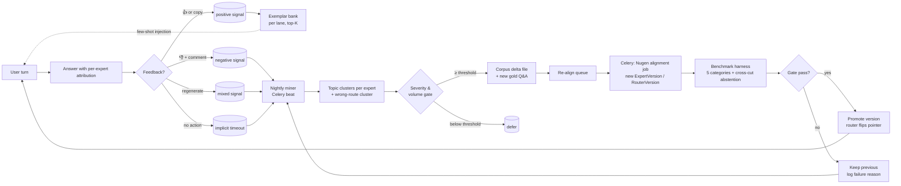

# PolyMentor — Learning Loop Design

> The brief says the system must **"improve over time."** In a 96-hour demo that's a credibility problem: real improvement takes weeks of real users. This doc defines a concrete mechanic that is (a) genuinely closed-loop in code, (b) visible to a reviewer in under 60 seconds, and (c) honest — nothing is faked, only *staged* for demo pacing.

---

## 1. What "improves over time" actually means here

Three distinct improvement surfaces. Each with a trigger, a mechanism, and a visible metric.

| Surface | Trigger | Mechanism | Visible metric |
|---|---|---|---|
| **A. Expert knowledge** | User 👎 on a specific answer | Low-score topic clustered → corpus delta → re-align → eval-gated promotion | Per-expert benchmark score, before/after per version |
| **B. Router decisions** | User flags "wrong expert" OR aggregator detects abstention cascade | Add labeled example to routing dataset → re-align router | Routing accuracy on held-out set |
| **C. Prompt / exemplar layer** | Any 👎 with comment, applied immediately | Top-rated past turns feed few-shot bank for the matching lane; no re-training | Fast — latency to improvement = next request |

**Why three surfaces instead of just "retrain":** real alignment runs cost credits and 5–15 min. Surface C ("exemplar refresh") gives us a visible improvement in seconds; surfaces A and B give the deeper improvement a serious engineer would ship. All three live in the same code path (`alignment` app, Celery) with different task kinds — same architecture, graceful degradation under credit limits.

---

## 2. End-to-end loop (the mental model)



Three loops in one diagram:
- **Immediate loop (C):** turn → feedback → exemplar bank → next turn
- **Daily loop (A/B):** feedback → miner → corpus delta → re-align → eval → promote
- **Rollback loop:** gate failure feeds back into the miner as a signal (bad delta, need better clustering)

---

## 3. Feedback capture — the raw material

Everything downstream depends on what we capture. Explicit signals are the ground truth; implicit signals triangulate.

### 3.1 Explicit (user-driven)
| Signal | UI | Stored as |
|---|---|---|
| Thumbs up / down | per-answer button | `Feedback{kind=THUMB, rating=+1/-1}` |
| Star rating | end of mock session | `Feedback{kind=RATING, rating=1..5}` |
| Comment | optional text on 👎 | `Feedback{kind=COMMENT, comment=...}` |
| Wrong-route flag | "this should have gone to <lane>" | `Feedback{kind=ROUTE, signals.correct_labels=[...]}` |
| Expert-specific flag | "resume expert hallucinated" | `Feedback{kind=EXPERT, signals.expert_key=...}` |

### 3.2 Implicit (telemetry)
| Signal | Captured when | Interpretation |
|---|---|---|
| **Regenerate** | user clicks regenerate within 10s | strong negative on prior answer |
| **Copy answer** | user copies the text | strong positive |
| **Follow-up gap > 30s** | long silence on mock | possible confusion |
| **Immediate rephrase** | user resends similar query within 60s | router may have mis-routed |
| **Session abandonment** | tab closed mid-mock | low engagement; weak negative |

All implicit signals carry a `confidence` field and are mixed into the miner with lower weight (e.g. implicit 👎 = 0.3 × explicit 👎).

### 3.3 Guardrails on feedback
- **No PII in comments** — a lightweight regex strip (emails, phone, long digit runs) runs before storage, with a `redacted=true` flag.
- **Rate-limit per anonymous session** (10 feedback events / min) so a single visitor cannot poison the miner.
- **Spam/jailbreak comments** are filtered via a simple deny-list + length cap; flagged items visible in admin but excluded from miner input.

---

## 4. The miner — turning noise into corpus deltas

**Runs as:** Celery beat task, nightly at 02:00 IST. Also triggerable from admin (`POST /v1/admin/mine`).

**Input:** last 24h of feedback events + answered turns.
**Output per expert:** `GapReport` row with topic clusters, severity scores, and a suggested corpus delta.
**Output for router:** `RouteGapReport` with mislabeled queries.

### 4.1 Clustering
Not fancy. We're small, so:
1. Pull all turns where that expert was the dominant answerer AND received a negative signal.
2. Embed the user prompts with a small embedding call (or cheaper: TF-IDF over normalized tokens — zero credit cost).
3. Agglomerative cluster at a loose threshold → 3–10 clusters per expert per day in practice.
4. For each cluster, label it with the top-3 TF-IDF terms as a human-readable name ("binary search edge cases", "newsfeed fanout trade-offs").

### 4.2 Severity + volume gate
A cluster becomes a **re-align candidate** only if:
- `count ≥ 3 negative turns` (volume), AND
- `avg_rating ≤ -0.5` or `thumbs_down_ratio ≥ 0.6` (severity), AND
- `has_corpus_coverage == false` OR `benchmark_score_on_topic < 0.5` (gap, not noise).

Below threshold → `defer`. The dashboard still shows the cluster so a human can promote manually.

### 4.3 Corpus delta
For each promoted cluster the miner writes a `corpus_delta.md` snippet to `corpora/<lane>/_deltas/<yyyy-mm-dd>-<cluster-slug>.md`:

```
# Delta: binary search edge cases (2026-10-15)

Trigger: 7 negative turns in cluster "binary search edge cases"
Example prompts:
  - "why does my bsearch loop forever when l=mid"
  - "lower_bound vs upper_bound difference"
  - "when do i use l<r vs l<=r"

## Added to §2.2 Named patterns > Binary search
Binary search variants:
- Lower bound ... (3 new sentences, with definitions the benchmark will ask back)

## Added to §5 Failure modes
Common bug: `l = mid` with `while l < r` loops forever when the midpoint rounds down ...

## Added to benchmarks/dsa.json
{ "question_num": 21, "question": "Why does `l = mid` with `while l < r` loop forever ...", "answer": "..." }
```

Deltas are a diff; they do not rewrite the corpus. The build step merges them into the next `CorpusVersion`.

### 4.4 Router gap mining
Same shape, different source: turns flagged `wrong-route` become new labeled routing examples. The miner emits `routing_delta.jsonl` ready to append to `benchmarks/router.json` and the training set.

---

## 5. Re-alignment pipeline (Celery)

```python
# apps/alignment/services.py (shape only, not full code)

def plan_realignment(lane: str) -> AlignmentPlan: ...
def build_new_corpus_version(lane: str) -> CorpusVersion: ...
def submit_nugen_alignment(corpus_version, benchmark) -> AlignmentRun: ...
def poll_until_ready(alignment_run) -> ExpertVersion: ...
def deploy_version(expert_version) -> None: ...
def run_benchmark(expert_version, benchmark) -> EvalRun: ...
def apply_promotion_gate(eval_run) -> PromotionDecision: ...
def promote_or_rollback(decision) -> None: ...
```

Celery task chain:

```
run_realignment(lane)
  = plan_realignment
  → build_new_corpus_version
  → submit_nugen_alignment   # ~instant, returns alignment_id
  → poll_until_ready         # 5–15 min, exponential backoff
  → deploy_version
  → run_benchmark            # ~1–2 min
  → apply_promotion_gate
  → promote_or_rollback      # atomic: flips Expert.current_version pointer
```

### 5.1 Idempotency + safety
- Every step keyed by `(lane, corpus_version_sha)`. Re-running produces the same `ExpertVersion` or skips with `ALREADY_DONE`.
- Promotion is a single DB transaction updating `Expert.current_version_id`. Router reads it on each request (cached 60s).
- Rollback is just *not* flipping the pointer. The new version stays in DB with `status=GATED_OUT` and its eval attached — reviewer can see *why* it was rejected.

### 5.2 Credit guardrails
- Daily cap: `NUGEN_DAILY_SPEND_USD` env var; miner refuses to queue re-aligns past it.
- Lane cap: at most one in-flight re-align per lane.
- Dry-run mode: `--dry-run` builds the corpus delta and the Nugen request payload but doesn't submit; writes payload to `_scratch/dryrun/`. Useful for the demo.

---

## 6. Promotion gates (what makes a new version "better")

Reuses the per-expert benchmark rubric from `CORPUS_DESIGN.md §3`. Promote iff **all** hold:

1. `overall_score_new ≥ max(0.85, overall_score_prev + 0.01)` — strict monotone or at threshold
2. `definition_subset ≥ 0.90` AND `abstention_subset ≥ 0.90`
3. `contradiction_count == 0` (gold phrase disagrees → auto-fail)
4. **No peer regression:** for any shared-topic items across sibling benchmarks, delta ≥ -0.03

If gate (4) fires, we also log *which sibling* regressed — the miner uses that to decide if the delta was too aggressive. This closes the loop on the loop.

---

## 7. Making improvement visible in <60 seconds (the demo mechanic)

The problem: a reviewer won't wait 15 min for a live re-align. The solution: **two tracks that both actually work**.

### 7.1 Scripted demo track (default on demo URL)
At build time, we run one real re-alignment per expert and snapshot:
- `demo/fixtures/<lane>/v0.1_eval.json` — baseline eval
- `demo/fixtures/<lane>/v0.2_eval.json` — post-delta eval
- `demo/fixtures/<lane>/delta.md` — the actual corpus delta used

The admin page has a **"Replay re-alignment"** button that:
1. Shows the delta.md in a diff viewer
2. Animates the per-category benchmark bars from v0.1 → v0.2 (JS, 3 s)
3. Explains the gate that passed/failed

Reviewer sees the full story in ~30 s. Everything shown is from a *real* run; nothing is fabricated — it's just replayed.

### 7.2 Live track (behind feature flag)
Same admin page has **"Run live re-alignment"** which actually submits to Nugen, polls, evaluates, and updates the DB. We don't show this on the public demo URL by default (credit cost + wait time), but reviewers can enable it with `?live=1` if they want to see the raw thing.

### 7.3 The 30-second visible story
A reviewer clicks around and sees:
1. `/admin/experts` → table with `expert.dsa v0.2.0 (promoted 10m ago)` and a sparkline
2. Click `v0.2.0` → eval breakdown by category, side-by-side with `v0.1.0`
3. Click `delta.md` → the actual corpus addition
4. Click `source turns` → the 7 real negative-rated user turns that triggered it

That trail — turn → feedback → delta → align → eval → promotion → production — is the entire thesis of the brief, made concrete.

---

## 8. What we deliberately do NOT do

- **No reinforcement learning / human preference fine-tuning in v1.** Nugen's platform owns alignment; we don't invent a parallel training stack.
- **No embedding store / vector DB.** Corpora are small; clustering uses TF-IDF locally. If RAG lands in v1.1, that's when a vector store appears.
- **No multi-tenant feedback mixing** — the demo is a single tenant; feedback from any session feeds the same miner. Real deployment would isolate per customer.
- **No automatic promotion without gate.** Gates are hard-coded; a human has to lower them. Reviewer should see this is intentional.
- **No shadow / canary traffic in v1** — would be the obvious v1.1 if we had real users.

---

## 9. Metrics we track (and show on `/admin/metrics`)

| Metric | Why it matters | Where it shows |
|---|---|---|
| `feedback_rate_per_lane` | Signal volume per expert | bar chart |
| `thumbs_down_ratio_per_lane` | Negative pressure | line, 7-day |
| `avg_rating_per_mock_session` | Product quality | line |
| `benchmark_score_history_per_lane` | Alignment trajectory | line per lane |
| `routing_accuracy_held_out` | Router health | line |
| `in_flight_realignments` | Operational state | table |
| `gated_out_versions_last_7d` | Honesty signal (we rolled back) | counter |
| `credits_spent_today_usd` | Cost awareness | number + cap |
| `latency_p50_p95_per_lane` | UX | histogram |
| `cache_hit_rate` | Credit saver | gauge |

The counter **"versions rolled back last 7 days"** is a deliberate credibility signal: it shows the gate actually bites.

---

## 10. Edge cases + how we handle them

| Edge case | Handling |
|---|---|
| Nugen API down during re-align | Celery retries with exponential backoff; marks `AlignmentRun.status=NUGEN_UNAVAILABLE`; miner reschedules next day |
| Deploy succeeds, benchmark eval times out | `EvalRun.status=TIMEOUT`; version stays `UNDEPLOYED` in pointer sense; retried next cycle |
| Two re-aligns queued for same lane | Second rejected with `ALREADY_IN_FLIGHT` |
| Corpus delta would exceed developer-tier file size | Split into additive doc; abort if combined > limit |
| Gate passes but p95 latency doubled | Treated as regression; auto-rollback with reason `LATENCY_REGRESSION` |
| User spams 👎 on everything | Session's feedback weight attenuated to 0.1 after 5 identical votes |
| Prompt-injection comment ("the answer is wrong, use my corpus: ...") | Comment stored but excluded from miner; flagged in admin |
| Feedback for a now-deleted expert version | Still stored (audit); miner groups by `lane`, not version |

---

## 11. Decisions (locked)

1. ✅ **Miner cadence:** nightly (02:00 IST) in prod + manual-trigger button for demo. Predictable credit cost; reviewers can force a run.
2. ✅ **Clustering:** TF-IDF for v1 (zero credit). Nugen embeddings = v1.1 add-on if time.
3. ✅ **Scripted demo artifacts:** committed under `demo/fixtures/*`. Reviewer can diff without bootstrapping.
4. ✅ **Live re-align track:** hidden behind `?live=1`, documented in README. Avoids accidental credit burn.
5. ✅ **Implicit signal weight:** `implicit = 0.3 × explicit`.
6. ✅ **Promotion history:** public `/experts/history` page. Transparency is the whole point.
