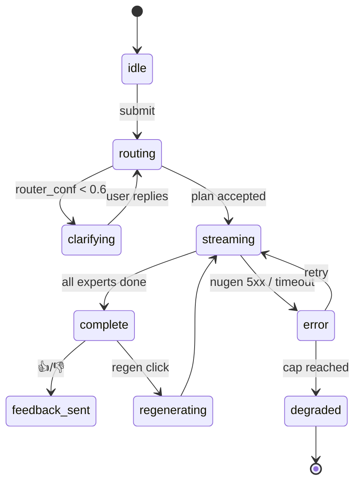

# PolyMentor — UX Walkthrough

> Screen-by-screen, state-by-state, interaction-by-interaction. The goal is zero rework at H 70 and no surprise edges on demo day. Everything here is cheap to build (HTMX + Tailwind CDN, Django templates, SSE), and everything maps to a backend view already in `ARCHITECTURE.md §9`.

---

## 1. Design principles

1. **Make the architecture visible.** Every screen surfaces at least one piece of the thesis (router decision, expert attribution, confidence, reconciliation, version history).
2. **One primary action per screen.** Reviewer should never ask "what do I click?"
3. **Nothing hidden behind auth** for the demo flow. Admin is 1-password-gated.
4. **Progressive disclosure.** Simple header, deep drawer. Default view is clean; auditability is one click away.
5. **No JS framework.** HTMX for partial swaps, Alpine.js (CDN) only for small toggles. Zero build step.
6. **Reduced-motion & keyboard-navigable.** Reviewer might be on a laptop with trackpad only; sometimes on a bad flight wifi.
7. **Mobile-safe but desktop-primary.** The reviewer will almost certainly be on desktop. We don't optimize for mobile but we don't break on it.
8. **Dark mode default** (Tailwind `dark:`), light-mode toggle. Looks pro, reduces eye strain in demo.

---

## 2. Global layout

```
┌─────────────────────────────────────────────────────────────────────────────┐
│  PolyMentor  ·  Ask  ·  Mock  ·  Experts  ·  Admin           arbaazpy / in  │
├─────────────────────────────────────────────────────────────────────────────┤
│                                                                             │
│                        [ page content, max-width 920px ]                    │
│                                                                             │
├─────────────────────────────────────────────────────────────────────────────┤
│  © Arbaaz Ali · built on Nugen · GitHub / LinkedIn · credits used $X.XX     │
└─────────────────────────────────────────────────────────────────────────────┘
```

**Nav items (5):**
- `Ask` — single-turn interface (default landing)
- `Mock` — multi-turn lightning mock interview
- `Experts` — public expert registry + version history (`/experts` and `/experts/history`)
- `Admin` — password-gated, feedback miner + re-align controls + metrics

**Footer always shows live credit usage** — honest signal to Nugen that we're mindful of spend.

---

## 3. Screen: `/` (Ask) — the hero

### 3.1 Default state

```
┌─ Ask ────────────────────────────────────────────────────────────────────┐
│                                                                          │
│  What should PolyMentor help you with?                                   │
│  ┌────────────────────────────────────────────────────────────────────┐  │
│  │ e.g. "Design a URL shortener for 1B/day, I have 2 weeks to ship"    │  │
│  │                                                                     │  │
│  └────────────────────────────────────────────────────────────────────┘  │
│                                                   [ Ask (⌘⏎) ]           │
│                                                                          │
│  Try one of these ↓                                                      │
│   • Design a URL shortener for 1B redirects/day. 2 weeks to ship.        │
│     ⓘ Showcases: router fan-out · expert reconciliation                  │
│   • Prep me for a Google backend SDE-2 loop next week                    │
│     ⓘ Showcases: parallel fan-out · multi-lane answer                    │
│   • Grade this STAR story: "[example]"                                   │
│     ⓘ Showcases: single-expert depth                                     │
│   • I confuse `l<r` vs `l<=r` in binary search                           │
│     ⓘ Showcases: parametric lock-in via alignment                        │
│   • Here's a weak resume bullet: "worked on APIs" — fix it.              │
│     ⓘ Showcases: resume expert + concrete rewrite                        │
└──────────────────────────────────────────────────────────────────────────┘
```

**States:**
- `idle` — above
- `clarifying` — router returned low confidence; shows "I want to make sure I route this well: {clarifying question}" with inline reply
- `routing` — loading shimmer on router banner, ~1s
- `streaming` — expert blocks fill in with SSE, confidence badge pulses until final
- `complete` — feedback + actions row appears

### 3.2 Routing banner (shown as soon as router responds)

```
┌─ Router ──────────────────────────────────────────────────────────────┐
│ Strategy: parallel · confidence 0.93                                   │
│ Dispatched to: sysdes · dsa · behav · mock                             │
│ [ why these experts? ]  [ see raw router output ]                      │
└───────────────────────────────────────────────────────────────────────┘
```

Clicking "why these experts?" opens an inline drawer:
```
Router reasoning (routing v0.1.0):
  Prompt contains: "design", "URL shortener", "ship", "2 weeks"
  → design task → sysdes (primary)
  → capacity/hash math → dsa (secondary)
  → shipping scope + stakeholders → behav
  → interview framing (implicit) → mock
  Strategy=parallel: no sequential dependency.
```

### 3.3 Expert blocks (one per expert that answered)

```
┌─ Architecture · sysdes v0.2.0 · conf 0.86 ────────────────────────────┐
│ L7 load balancer → stateless app tier → KV store ...                   │
│ ...                                                                    │
│ Caveats: assumes 10:1 cache hit ratio                                  │
└───────────────────────────────────────────────────────────────────────┘
```

- Header: `title · expert_key version · confidence` (color-coded dot: green ≥0.8, amber 0.5–0.8, red <0.5 / abstained)
- Body: the structured sub-claims rendered as prose with inline citation chips (`[sysdes#2.3]` → tooltip shows corpus snippet)
- Caveats row at bottom if present

### 3.4 Reconciliation callout (the money shot)

Rendered between the two conflicting expert blocks when a reconciliation fires:

```
┌─ ⚠ Reconciled ─────────────────────────────────────────────────────────┐
│ sub-claim: hash.length                                                 │
│ sysdes said: 7 chars (conf 0.74)                                       │
│ dsa    said: 8 chars (conf 0.81)   ← chosen                            │
│ Rule applied: lane ownership (hash.* → dsa)                            │
│ [ see both raw outputs ]                                               │
└───────────────────────────────────────────────────────────────────────┘
```

Clicking the raw-outputs link slides a side drawer with the untouched expert JSON.

### 3.5 Action row (bottom, after streaming completes)

```
👍  👎   [ regenerate ]   [ copy ]   [ permalink ]   [ see trace ]
```

- 👎 opens inline textarea for optional comment; submit sends `Feedback`
- 👎 also offers "actually this needed {lane}" chips so wrong-route feedback is cheap
- `permalink` is `/t/<turn_id>` — public read-only view, shareable with reviewers
- `see trace` opens a side panel: router decision + each expert call (model id, latency, token counts, raw response). This is the audit log in UI form.

### 3.6 Error states
- **Nugen 429 / 504**: inline retry banner, "Nugen is throttling us; retrying in 2s..." with a countdown
- **Expert deployment pending**: banner "Expert <lane> is being promoted; using previous version v0.1.0 for this turn"
- **All experts abstained**: aggregator renders a single block: "No expert in the current fleet covers this. Try rephrasing, or see /experts for lane scopes."
- **Credit cap reached**: banner "Daily credit cap reached; demo is read-only until tomorrow. See cached showcase examples below." + links to permalinks.

---

## 4. Screen: `/mock` — Lightning mock interview

### 4.1 Entry
```
┌─ Mock Interview ──────────────────────────────────────────────────────┐
│ Format: Lightning (10 min)      [ Full round (45 min) → requires login ]│
│ Lane focus: ○ auto  ○ sysdes  ○ dsa  ○ behav  ○ mixed                  │
│ Target role: [ Senior Backend Engineer           ▾ ]                   │
│                                                   [ Start mock ]       │
└───────────────────────────────────────────────────────────────────────┘
```

### 4.2 In-session (per turn)

Two columns:

**Left (conversation):**
```
Mock (expert.mock v0.1.0):
  "Design a rate limiter for an API with 1000 req/s per user."

You:
  [ textarea ]
                                                    [ Submit (⌘⏎) ]
```

**Right (live rubric, updating as sub-claims are graded):**
```
Live rubric
┌─ Correctness ─────────────── 3/5 ─┐
│ · capacity math         (dsa)  ✓   │
│ · consistency choice    (sysdes) ○  │
│ · failure modes         (sysdes) ○  │
└───────────────────────────────────┘
┌─ Communication ──────────── 4/5 ─┐
│ · structure            (behav) ✓   │
│ · clarity              (behav) ✓   │
└───────────────────────────────────┘
┌─ Iteration ───────────────── 2/5 ─┐
│ · responded to probe   (mock)  ○   │
└───────────────────────────────────┘

Dispatched silently to: dsa · sysdes · behav
```

Reviewer *sees* the fleet working on the right while the mock conversation plays on the left — the fallback wow (5.2) realized.

### 4.3 End of session
```
┌─ Mock Summary ────────────────────────────────────────────────────────┐
│ Overall: 3.4 / 5                                                       │
│                                                                        │
│ Strengths                                                              │
│   · Capacity math clean (dsa confirmed)                                │
│   · Good back-pressure framing (sysdes confirmed)                      │
│                                                                        │
│ Improvements                                                           │
│   · Did not address eventual consistency trade-off                     │
│   · Scope creep in minute 7; interviewer had to re-anchor              │
│                                                                        │
│ Transcript: [ download ]      Share: [ permalink ]                     │
│ Rate this mock:  ★ ★ ★ ★ ☆                                             │
└───────────────────────────────────────────────────────────────────────┘
```

Rating + per-turn thumbs feed the miner.

---

## 5. Screen: `/experts` — Public registry

### 5.1 List view
```
┌─ Experts ─────────────────────────────────────────────────────────────┐
│                                                                        │
│  Expert         Lane             Version   Score   Status  Updated     │
│  ─────────────────────────────────────────────────────────────────────  │
│  expert.dsa     DSA              v0.2.0    89.5%   ●live   10m ago     │
│  expert.sysdes  System design    v0.1.0    78.0%   ●live   2d ago      │
│  expert.behav   Behavioral       v0.1.0    82.0%   ●live   2d ago      │
│  expert.resume  Resume           v0.1.0    85.0%   ●live   2d ago      │
│  expert.mock    Interviewer      v0.1.0    80.0%   ●live   2d ago      │
│  router         Mother           v0.1.0    91.2%   ●live   1d ago      │
│                                                                        │
│  Rolled back last 7 days: 2         Credits spent today: $4.80 / $12   │
└───────────────────────────────────────────────────────────────────────┘
```

Click any row → detail page.

### 5.2 Expert detail (`/experts/dsa`)

```
┌─ expert.dsa ──────────────────────────────────────────────────────────┐
│ Lane: DSA — complexity, patterns, DP, graphs ...                       │
│ Current version: v0.2.0 (promoted 10m ago)                             │
│                                                                        │
│  Benchmark trend (last 10 versions)                                    │
│  ┌─ sparkline ──────────────────────────────────────────┐              │
│  │ 0.72 → 0.78 → 0.81 → 0.80 → 0.84 → 0.89              │              │
│  └──────────────────────────────────────────────────────┘              │
│                                                                        │
│  Version history                                                       │
│  v0.2.0  ●promoted   89.5%   [ eval ] [ corpus diff ] [ triggered by ] │
│  v0.1.0  ●gated_out  72.0%   [ eval ] [ reason: abstention subset ]    │
│  v0.1.0  ●promoted   78.0%   [ eval ] [ corpus diff ]                  │
│  v0.0.1  ●initial    71.0%   [ eval ]                                  │
│                                                                        │
│  Current corpus: 3,214 words · [ view ] · [ download .md ]              │
│  Current benchmark: 20 items · [ view ]                                │
└───────────────────────────────────────────────────────────────────────┘
```

Everything linked. Reviewer can see the exact text, benchmark, and gate reason behind every version.

### 5.3 Promotion history (`/experts/history`)
Timeline view across all experts; filters by `promoted` / `gated_out`. Prime "transparency" surface for the brief's "improves over time" claim.

---

## 6. Screen: `/admin` — Operator view (password-gated)

Simple HTTP basic auth or a shared bearer token stored in env. Nothing fancy; this is a demo.

### 6.1 Dashboard
```
┌─ Admin ───────────────────────────────────────────────────────────────┐
│ Credits:   $4.80 / $12 today    cap $20                                │
│ In-flight: 0 re-aligns          Queue: 2 pending                       │
│ Last miner run: 14m ago         Clusters created: 3                    │
│                                                                        │
│ [ Run miner now ]  [ Replay re-align demo ]  [ Pause re-aligns ]       │
│                                                                        │
│  Pending re-align candidates                                           │
│  Lane     Cluster              Severity   Volume   [action]            │
│  dsa      binary-search-edge   0.78       7        [ dry-run ] [ run ] │
│  sysdes   fanout-tradeoffs     0.62       4        [ dry-run ] [ run ] │
│                                                                        │
│  Recent feedback (last 50)                                             │
│  ...                                                                   │
└───────────────────────────────────────────────────────────────────────┘
```

### 6.2 Replay re-align demo
A dedicated route `/admin/replay/<lane>` that plays the pre-committed artifact:

1. Shows `delta.md` in a diff viewer (red/green)
2. Lists the 7 real negative turns that drove the delta (with permalinks)
3. Animates per-category benchmark bars from `v0.1_eval.json` to `v0.2_eval.json` (CSS transition, 3s)
4. Shows which gate(s) passed and the final decision

Reviewer sees the full turn → feedback → delta → align → eval → promotion story without waiting.

### 6.3 Live re-align (behind `?live=1`)
Admin page shows the same controls but hitting `[ run ]` actually submits to Nugen. Celery task progress streams via SSE: `submitting → polling (3m) → polling (6m) → deployed → evaluating → gated/promoted`.

---

## 7. Screen: `/t/<turn_id>` — Public permalink

Read-only snapshot of a single turn. Includes:
- Original prompt
- Router decision
- All expert blocks + reconciliations
- Trace drawer
- "Try this yourself" button that pre-fills the Ask page

Shareable in support tickets, PR descriptions, etc. Also what Nugen reviewers can paste into the application comment.

---

## 8. States and transitions (summary)



---

## 9. Component inventory (what we actually build)

| Component | Lines of HTML/CSS/JS (est) | Reused across | Notes |
|---|---|---|---|
| `base.html` layout + nav + footer | ~80 | all pages | Tailwind CDN, dark mode toggle |
| `ask.html` | ~120 | / | Prompt panel + try-these + response container |
| `_router_banner.html` partial | ~30 | ask, mock | HTMX swap target |
| `_expert_block.html` partial | ~60 | ask, mock | Confidence badge, citation chips |
| `_reconciliation.html` partial | ~40 | ask | ⚠ callout |
| `_trace_drawer.html` partial | ~60 | ask, mock | Side drawer |
| `mock.html` | ~140 | /mock | Two-column layout, live rubric |
| `experts_list.html` | ~70 | /experts | Table |
| `expert_detail.html` | ~110 | /experts/<key> | Sparkline (sparkline-js CDN), version history |
| `history.html` | ~80 | /experts/history | Timeline |
| `admin_dashboard.html` | ~120 | /admin | Metrics + action buttons |
| `admin_replay.html` | ~100 | /admin/replay/<lane> | Animated bars |
| `permalink.html` | ~40 | /t/<id> | Reuses expert_block partial |
| Alpine.js toggles | ~50 total | across | drawers, dark mode |
| SSE client | ~40 | ask, mock | Vanilla fetch + reader |
| **Total** | **~1,140 lines** | | ~1 day of UI work |

CSS: Tailwind CDN only. No custom stylesheet beyond ~30 lines of utility overrides.

---

## 10. Accessibility & demo polish

- All interactive elements keyboard-reachable; focus rings visible.
- Color is never the only signal (confidence dot + text).
- Reduced-motion preference disables bar animations.
- Favicon + OG meta tags for clean link-sharing (reviewer may paste permalink in Slack).
- `/healthz` returns `{ok: true, version: <git_sha>, experts_live: 5}` — reviewer-visible health signal.
- 404 and 500 pages are hand-styled, not Django default.
- No console errors in production. (CI check if time.)

---

## 11. What ships in v1 vs v1.1

**v1 (96h):**
- Ask + Mock + Experts + Admin + Permalink
- Router banner, expert blocks, reconciliation callout, trace drawer, raw-outputs drawer
- Live rubric in mock
- Replay-demo in admin
- Dark mode default + toggle
- Permalinks

**v1.1 (post-interview, if invited):**
- Mobile layout polish
- Nugen-embeddings-based clustering in miner
- RAG for sysdes
- Multi-tenant feedback isolation
- OAuth / GitHub login
- Shareable "my prep history" page per user

---

## 12. Decisions (locked)

1. ✅ **Theme:** dark default with light toggle.
2. ✅ **Admin auth:** shared bearer token via `/admin/login` form.
3. ✅ **Permalinks:** public, UUID in URL (`/t/<uuid>`). Unguessable, shareable.
4. ✅ **Live rubric placement:** right column at ≥1024px, collapsible bottom drawer below.
5. ✅ **"Try these" order:** URL shortener pinned first always.
6. ✅ **Credit-cap behavior:** degrade to cached showcase permalinks + banner.